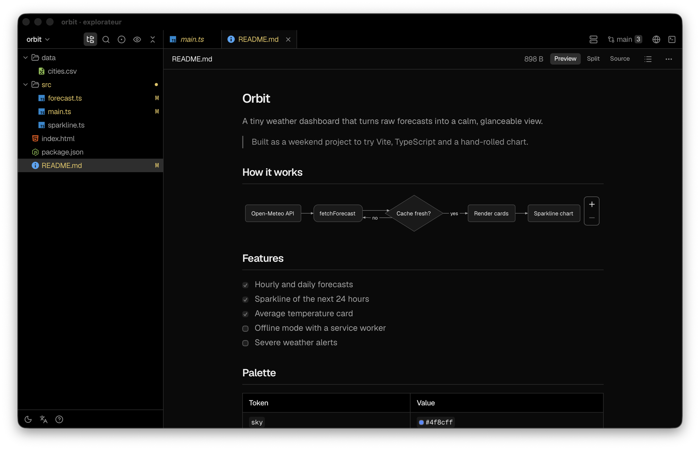
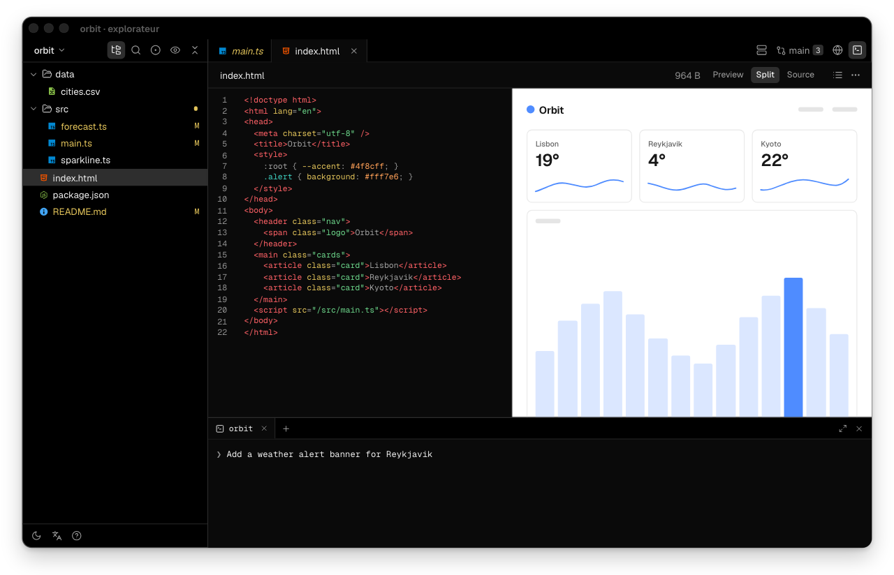
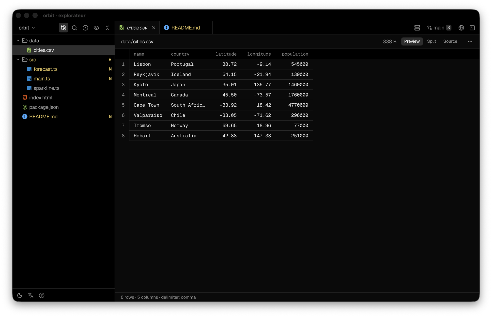
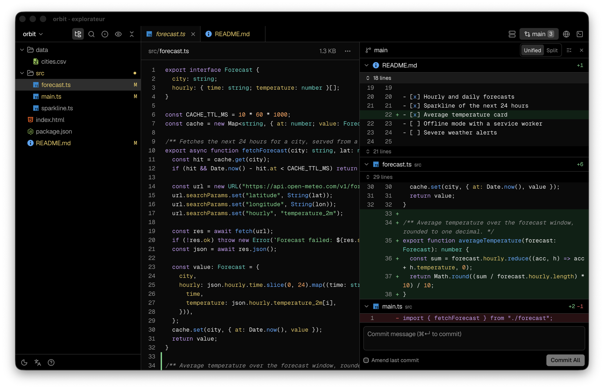
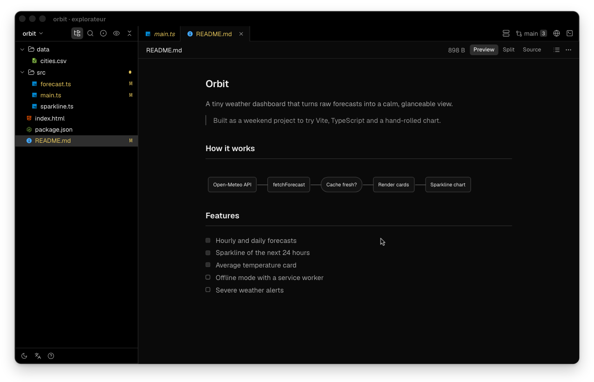
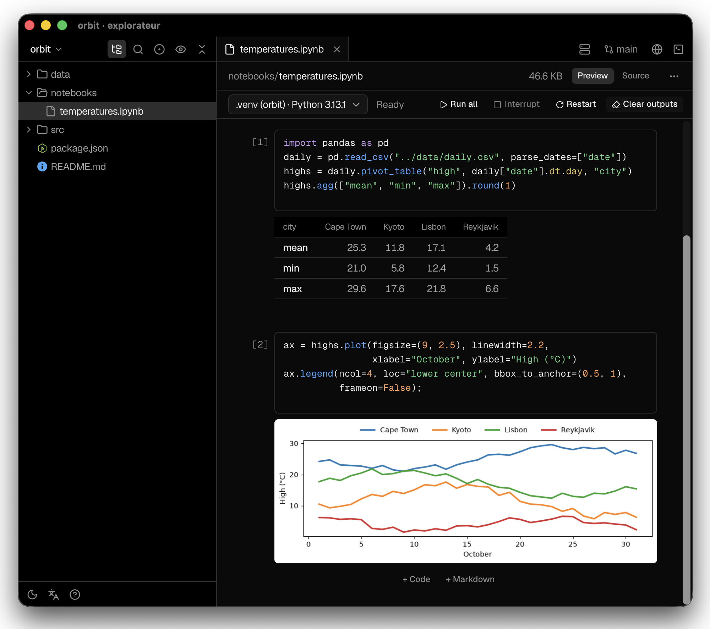

<h1 align="center">Explorateur</h1>

<p align="center">
  <strong>The quiet window next to your coding agent.</strong><br>
  Read, review and run what it builds, without opening an IDE.
</p>

<p align="center">
  
  
  
  
</p>

<p align="center">
  
</p>

Your agent writes code in a terminal. Explorateur sits beside it and shows you the result: the
README rendered with its diagrams, the diff as it grows, the dev server in a tab, the next file
you want to read. Open a folder and look. There is no project setup, no language server and no
extension to install.

## Why Explorateur

- **Made for watching, not typing.** An IDE is built to write code. When an agent writes it,
  you mostly read, compare and run. Explorateur puts those three things first.
- **Always in sync.** Files reload the moment they change on disk, and anything changed since
  you last read it is marked. You never look at a stale version.
- **Light and native.** A small Rust and Tauri app for macOS that opens in a blink and stays
  out of the way. Your files are never copied, moved or indexed elsewhere.
- **Private by design.** Everything runs on your Mac. The app has no account, no telemetry and
  no server. Git and the GitHub CLI run with your own credentials, only when you ask.
- **Safe to keep open.** Nothing is ever deleted for good: removing a file sends it to the
  Trash, and saving checks first that nobody else changed the file.

## Features

### Read anything the agent produces

- **Markdown**, GitHub flavoured: tables, task lists, footnotes, colour swatches next to hex
  codes, raw HTML (sanitised) and **Mermaid** diagrams you can zoom.
- **Code** with syntax highlighting for dozens of languages.
- **Data files**: CSV and TSV as tables, JSON and YAML as readable trees.
- **HTML pages** rendered in a sandbox, **images** and **PDF**.
- **Outline** of the current document, and **Preview / Split / Source** views side by side.

<p align="center">
  <picture>
    <source media="(prefers-reduced-motion: reduce)" srcset="apps/explorateur/media/html-preview-poster.png">
    
  </picture>
</p>

<p align="center">
  
</p>

### Review the changes

- A **Changes** pane with every modified file and its diff, unified or split.
- **Stage, commit, push and pull** without leaving the window. `⌘↵` commits, `⌘⇧↵` commits and
  pushes.
- Jump between hunks with `⌥↑` and `⌥↓`.
- **GitHub issues** of the repository, read and created through your own `gh`.
- **Permalink** to the current line on GitHub, ready to paste.

<p align="center">
  
</p>

### Run the project

- An **integrated terminal** with tabs, search and clickable links.
- **Dev servers and apps detected** in the folder: Vite, Next.js, Expo, Electron, Flutter,
  Android, Xcode, Rust and Swift projects start in one click.
- A built-in **browser tab** shows the running site next to its code.
- **Jupyter notebooks** open as notebooks: edit the cells and run them in a local Python
  kernel, from the project's `.venv` or any installed kernel. Saving keeps the file readable
  by Jupyter.

<p align="center">
  <picture>
    <source media="(prefers-reduced-motion: reduce)" srcset="apps/explorateur/media/servers-poster.png">
    
  </picture>
</p>

<p align="center">
  
</p>

### Move fast

- **Quick open** (`⌘P`): fuzzy search across files and recent folders. Type `name:42` to land
  on line 42.
- **Search in files** (`⌘⇧F`) and a **command palette** (`⇧⌘P`).
- **Tabs**, back and forward through visited files, and a **session per folder** that reopens
  where you left off.
- Keyboard first: the whole tree, panes and tabs work without a mouse. Press `?` for the list.
- **Light and dark themes**, zoom, and an interface in **English or French**.

### Edit when you need to

- A small editor with find, go to line and a **save-conflict check**.
- New file, new folder, rename, move to Trash, reveal in Finder, copy path.

### Open from anywhere

- **Finder**: double-click a file, or use _Open With_.
- **Terminal**: `explorateur` opens the current folder, `explorateur src/main.rs:40` opens a file
  at a line.

## Install

Explorateur runs on macOS, on Apple silicon and Intel. Signed downloads and a Homebrew cask are
coming. Until then, build it from source in a few minutes.

### Build from source

You need the Xcode Command Line Tools (`xcode-select --install`), [Node.js](https://nodejs.org)
with [pnpm](https://pnpm.io), and [rustup](https://rustup.rs). The Rust version is pinned by
`rust-toolchain.toml` and installed automatically.

```bash
git clone https://github.com/LouisLv-pro/explorateur.git
cd explorateur
pnpm install
pnpm --filter explorateur tauri build --bundles app
```

Then move the app to your Applications folder:

```bash
cp -R target/release/bundle/macos/explorateur.app /Applications/
```

### Command line (optional)

```bash
apps/explorateur/scripts/installer-cli.sh
```

This links the `explorateur` command into `~/.local/bin`. Pass another folder as argument to
install it elsewhere.

### Default app for text files (optional)

In the app menu, choose **Make Default for File Types…**, then pick the groups (Markdown and
text, data, HTML, code). macOS asks you to confirm once per file type, one window at a time.

## What it uses on your Mac

Explorateur relies on tools you probably have already. Without one of them, only the matching
feature is unavailable.

| Tool                                      | Used for                                |
| ----------------------------------------- | --------------------------------------- |
| `git`                                     | the Changes pane, commit, push and pull |
| [`gh`](https://cli.github.com), signed in | GitHub issues                           |
| Xcode, Android Studio, Node.js…           | starting the matching projects          |

The app keeps very little: a small SQLite file in
`~/Library/Application Support/app.explorateur.mac/` (recent folders, what you last
read) and its window preferences (theme, language, open tabs of each folder). Nothing leaves your
Mac.

## Development

```bash
pnpm --filter explorateur tauri dev   # the app with hot reload
```

The app lives in `apps/explorateur`: `core` holds the logic in plain Rust, `src-tauri` the
desktop shell, `src` the React interface. This repository carries what you need to build and
run it; the test suite lives in the development repository.

## Contributing

Bug reports and ideas are very welcome as [issues](https://github.com/LouisLv-pro/explorateur/issues).
This repository is published from a private development repository, so pull requests cannot be
merged as they are: open an issue first, and accepted changes are applied upstream and credited
to you.

## License

[MIT](LICENSE)
